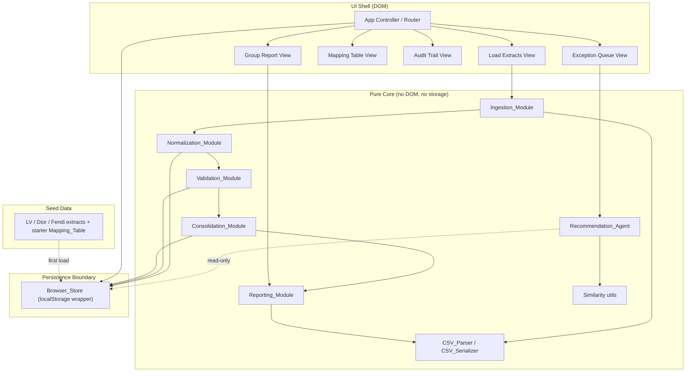
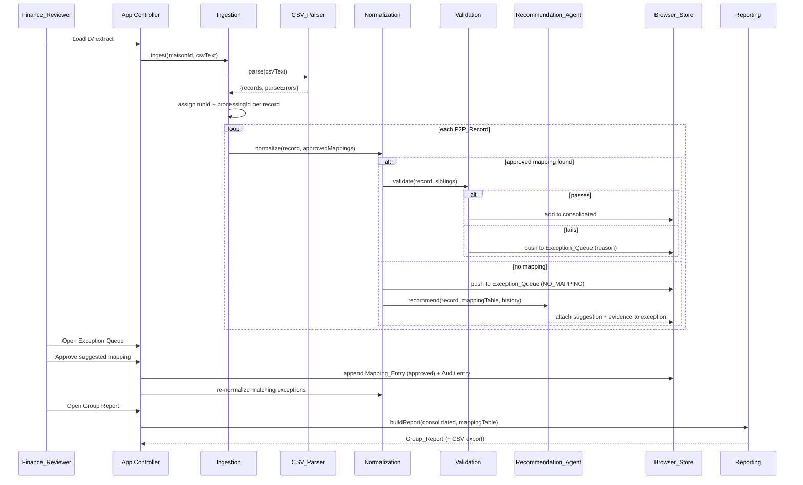
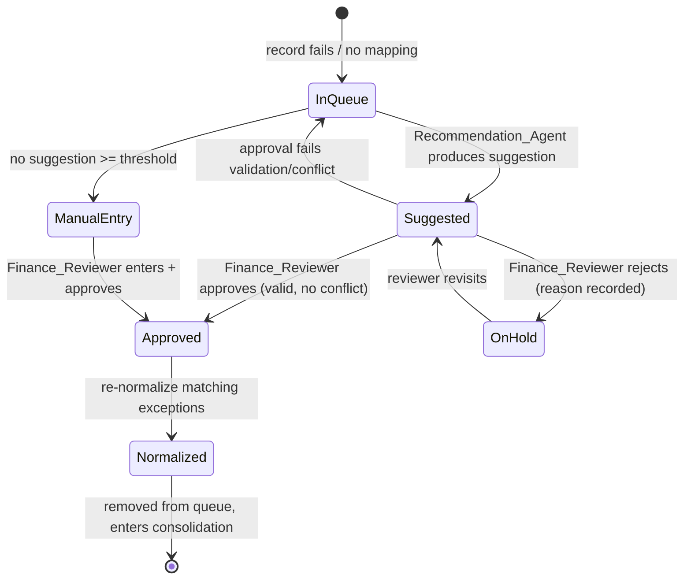

# Design Document

## Overview

The Cross-Maison P2P Reconciliation prototype is a **plain static web application** — HTML, CSS, and vanilla JavaScript (ES modules) — that runs entirely in the browser and is deployable on GitHub Pages with no build step, no bundler, no backend, and no server-side database. All state lives in the browser via `localStorage` (the **Browser_Store**), and all processing (CSV parsing, normalization, validation, recommendation, consolidation, reporting) happens client-side.

The application models a governed information layer for LVMH: each Maison (Louis Vuitton, Dior, Fendi) keeps its own local ERP codes and currency, and the System translates those into canonical LVMH codes through a **centrally governed Mapping_Table**. The core governance principle is **the agent recommends, the human approves**: the client-side `Recommendation_Agent` is a heuristic string-similarity matcher that proposes mappings with a confidence score and human-readable evidence, but it never mutates the Mapping_Table. Only a `Finance_Reviewer` approval mutates the Mapping_Table, and every mutation appends to an **append-only Audit_Trail**.

The end-to-end pipeline is:

```
Load Maison CSV  →  Parse (CSV_Parser)  →  Ingest (assign run IDs)
   →  Normalize against approved Mapping_Table
   →  Validate (required fields, 3-way match, duplicate PO)
   →  pass ─────────────────────────────────────────────┐
   →  fail / no mapping  →  Exception_Queue               │
          →  Recommendation_Agent (suggestion + evidence) │
          →  Finance_Reviewer approve/reject              │
                → approve: mutate Mapping_Table + Audit    │
                           re-normalize matching exceptions│
   →  Consolidate normalized records  ◄───────────────────┘
   →  Group_Report (auto / judgment / exception counts, CSV export)
```

### Design Goals and Key Decisions

| Decision | Rationale |
| --- | --- |
| Vanilla JS ES modules, no build | Req 1 mandates no build step; ES modules are served natively by GitHub Pages and keep the code modular without tooling. |
| `localStorage` as the single store | Req 2 mandates browser persistence; `localStorage` is synchronous, simple, and survives reloads. A thin `Browser_Store` wrapper isolates this choice. |
| Pure functional core, thin UI shell | Parsing, normalization, validation, similarity, and consolidation are implemented as pure functions over plain data. This makes the pipeline deterministic, unit- and property-testable in Node, and keeps DOM concerns in a separate UI layer. |
| Agent is read-only | Req 11/12 require the agent to never alter master data. The agent returns a *suggestion object*; only `approveMapping()` writes to the store. |
| Append-only audit | Req 13 requires retention; the audit module only ever appends, never rewrites prior entries. |
| Seed on first load | Req 2.6 / Req 3 require seeded data; a `seed/` module loads LV/Dior/Fendi extracts and a starter Mapping_Table when the store is empty. |

## Architecture

The System is organized into three layers: a **pure core** (domain logic, no DOM, no storage), a **persistence boundary** (`Browser_Store`), and a **UI shell** (controller + views). The pure core is the only place business rules live; it is driven by the UI controller and reads/writes exclusively through the persistence boundary.



### Pipeline Sequence (ingest → report)



### Approval governance flow



## Components and Interfaces

All core modules are pure ES modules exporting functions over plain JavaScript objects. No core module imports the DOM or `localStorage` directly; the UI controller wires them to the `Browser_Store`.

### CSV_Parser / CSV_Serializer (`src/core/csv.js`)

Handles RFC-4180-style CSV (quoted fields, embedded commas, escaped quotes, `\r\n` or `\n` line endings). The common LVMH extract format defines **nine columns in a fixed order**:

```
supplierCode, accountCode, costCenter, poRef, receiptRef, invoiceRef, quantity, price, currency
```

```js
// parse CSV text into typed P2P_Records, collecting per-row errors.
// header row is required and must contain the nine known column names.
export function parseCsv(csvText) → {
  records: ParsedRow[],      // one per valid data row (field values as strings/typed)
  parseErrors: ParseError[]  // { rowNumber, column, reason }
}

// serialize records back into CSV text in the fixed nine-column order,
// writing a header row. Round-trip safe (see Property 1).
export function serializeCsv(records) → string

// low-level helpers (exported for testing)
export function splitCsvLine(line) → string[]
export function escapeCsvField(value) → string
```

`parseCsv` validates each field against the type/range rules (Req 4.2): `quantity` is an integer 0–999,999,999; `price` is a decimal 0.00–999,999,999.99 with ≤ 2 decimal places; `currency` is a 3-letter A–Z code. Rows that are missing a required column or violate a type/range rule are **excluded** and recorded in `parseErrors` with `{rowNumber, column, reason}`; parsing continues (Req 4.5, 4.6).

### Ingestion_Module (`src/core/ingestion.js`)

```js
// Parse an extract for one Maison, tag every record with the Maison id
// and a processing id unique within the current run.
export function ingestExtract(maisonId, csvText, runId) → {
  records: P2P_Record[],   // each has maisonId, processingId, runId, local fields
  parseErrors: ParseError[]
}

// processing id generator — unique across all records in a run
export function makeProcessingId(runId, sequence) → string   // e.g. "run-3:000042"
```

`processingId` is `${runId}:${zeroPaddedSequence}`; `runId` is a monotonic counter persisted in the store, guaranteeing uniqueness across all records within a reconciliation run (Req 4.4).

### Normalization_Module (`src/core/normalization.js`)

```js
// Find an APPROVED mapping for (maisonId, supplierCode, accountCode).
export function findApprovedMapping(record, mappingTable) → Mapping_Entry | null

// Apply mapping: returns a copy with lvmhSupplierId + lvmhAccountCode set,
// preserving all original local codes (Req 16.3).
export function normalizeRecord(record, mappingEntry) → P2P_Record

// Drive a batch: records with an approved mapping go to validation;
// records without one are routed to the Exception_Queue as NO_MAPPING.
export function normalizeBatch(records, mappingTable) → {
  normalized: P2P_Record[],        // mapping applied, ready to validate
  unmapped: ExceptionEntry[]       // reason = "NO_MAPPING"
}

// Re-run after an approval: find queued exceptions a new entry now matches.
export function renormalizeExceptions(exceptionQueue, mappingTable) → {
  resolved: P2P_Record[],          // now normalized, remove from queue
  stillQueued: ExceptionEntry[],
  failures: ExceptionEntry[]       // normalization failed → NORMALIZATION_FAILED
}
```

Only entries with `status === "approved"` are considered (Req 5.4, 6.1, 12.5). Normalization never modifies source local codes (Req 16.2, 16.3).

### Validation_Module (`src/core/validation.js`)

```js
export function validateRequiredFields(record) → ValidationResult
export function threeWayMatch(record) → ValidationResult   // price / currency / quantity
export function detectDuplicatePO(record, priorRecordsInMaison) → ValidationResult

// Compose all checks; returns pass or the first failure reason with detail.
export function validateRecord(record, context) → {
  passed: boolean,
  reason?: ExceptionReason,       // MISSING_FIELD | MISSING_REFERENCE | PRICE_MISMATCH
                                  // | CURRENCY_MISMATCH | QUANTITY_MISMATCH | DUPLICATE_PO
  detail?: object                 // offending field / conflicting processingIds / diffs
}
```

Required fields: `supplierCode, accountCode, poRef, receiptRef, invoiceRef, quantity, price, currency` (Req 7.1). The **3-way match** compares the PO, receipt, and invoice sides on price (absolute difference must be 0.00, Req 8.3), currency (all identical, Req 8.4), and quantity (all equal, Req 8.5); a missing reference routes to the queue with `MISSING_REFERENCE` (Req 8.2). Failing records retain their data unchanged (Req 8.2–8.5) and keep their specific reason (Req 7.3). Duplicate detection is scoped **per Maison** on `poRef`; the later record is flagged `DUPLICATE_PO` and the exception entry retains references to both conflicting records (Req 9.2, 9.3).

> **3-way match data note:** the common extract carries one `price`, `currency`, and `quantity` per record. To exercise 3-way match semantics against PO/receipt/invoice *sides*, the record model carries optional per-side fields (`poPrice/receiptPrice/invoicePrice`, etc.); when a seed/extract provides only the single top-level values, all three sides default to those values so a well-formed record matches by construction. Validation-failure seed rows populate divergent per-side values to trigger `PRICE_MISMATCH` / `CURRENCY_MISMATCH` / `QUANTITY_MISMATCH`.

### Recommendation_Agent (`src/core/recommendation.js`)

```js
// Produce a suggested Mapping_Entry for an unmapped record, plus evidence.
// 100% client-side, no network (Req 11.5).
export function recommendMapping(record, mappingTable, options) → {
  status: "SUGGESTED" | "NO_SUGGESTION" | "ERROR",
  suggestion: Mapping_Entry | null,   // read-only candidate, status "suggested"
  confidence: number,                 // 0.00 .. 1.00 inclusive (Req 11.3)
  evidence: SupportingEvidence        // matched terms, per-term scores, history used
}
```

The agent is **read-only**: `suggestion` is a candidate object with `status: "suggested"` that is never written to the store by the agent (Req 11.1, 12.1). If no candidate reaches the configured `similarityThreshold`, it returns `status: "NO_SUGGESTION"` (Req 11.6). If the computation throws, the controller catches it and surfaces `status: "ERROR"`, keeping the record queued (Req 11.7). The algorithm is specified in detail in **Recommendation / Similarity Algorithm** below.

### Consolidation_Module (`src/core/consolidation.js`)

```js
// Combine all normalized + validated records into the LVMH common structure.
export function consolidate(normalizedPassedRecords) → ConsolidatedRecord[]

// Records in the Exception_Queue are excluded by construction (they never
// reach this module). Resolved records are re-fed on approval.
```

Each consolidated record is represented by its `lvmhSupplierId` and `lvmhAccountCode` while retaining original local codes (Req 14.2, 16.3).

### Reporting_Module (`src/core/reporting.js`)

```js
export function buildGroupReport(consolidated, mappingTable, counts) → Group_Report
// Group_Report includes: rows (common currency), local→LVMH supplier mapping,
// and counts { autoNormalized, financeJudgment, exceptionsRemaining } (Req 15.3).

export function exportGroupReportCsv(groupReport) → string   // via CSV_Serializer
```

"Common currency" for the prototype is a fixed presentation currency (EUR); records of other currencies are presented with their original currency column plus a `commonCurrency` label (no FX conversion is performed — the prototype demonstrates the comparable *structure*, not exchange-rate math).

### Persistence — Browser_Store (`src/store/browserStore.js`)

```js
export const KEYS = {
  mappingTable:  "p2p.mappingTable.v1",
  exceptionQueue:"p2p.exceptionQueue.v1",
  consolidated:  "p2p.consolidated.v1",
  auditTrail:    "p2p.auditTrail.v1",
  runCounter:    "p2p.runCounter.v1",
  meta:          "p2p.meta.v1"
};

export function load(key, fallback) → any          // JSON.parse, fallback on miss
export function save(key, value) → void            // JSON.stringify
export function appendAudit(entry) → void          // append-only (Req 13.3)
export function isFirstLoad() → boolean
export function seedIfEmpty(seedData) → void        // Req 2.6 / Req 3
export function resetAll() → void                   // demo convenience
```

`appendAudit` always reads the current array and pushes; it never replaces or deletes prior entries (Req 13.3). A `meta` object stores schema version and the similarity threshold.

### UI Controller & Views (`src/ui/`)

A hash-router controller (`appController.js`) renders one of five views and mediates between the DOM and the pure core. Views are render functions that take state and return/patch DOM, plus event handlers that call the controller.

```js
// appController.js
export function init() → void                    // seed, restore state, route
export function route(hash) → void               // "#load" | "#exceptions" | ...
export function loadExtract(maisonId, csvText) → void
export function approveMapping(exceptionId, mappingEntryDraft, reviewerId) → Result
export function rejectResolution(exceptionId, reason) → void
export function exportReport() → void            // triggers CSV download (Blob)
```

Views (Req 17.2): `loadExtractsView`, `exceptionQueueView`, `mappingTableView`, `auditTrailView`, `groupReportView`. On a resolution the controller refreshes the Exception Queue, Mapping Table, and Group Report views (Req 17.3).

## Data Models

All models are plain JSON-serializable objects (no classes needed for persistence).

### P2P_Record

```js
{
  processingId: "run-3:000042",   // unique within run (Req 4.4)
  runId: "run-3",
  maisonId: "LV",                 // "LV" | "DIOR" | "FENDI" (Req 4.3, 16.1)

  // original Maison local codes — never modified (Req 16.3)
  supplierCode: "SUP-1042",
  accountCode: "6110",
  costCenter: "CC-PARIS-01",
  poRef: "PO-55012",
  receiptRef: "GR-55012",
  invoiceRef: "INV-55012",
  quantity: 10,                   // int 0..999,999,999
  price: 1250.00,                 // decimal 0.00..999,999,999.99, <=2 dp
  currency: "EUR",                // ISO 4217, 3 letters

  // optional per-side values for 3-way match (default to top-level)
  poPrice: 1250.00, receiptPrice: 1250.00, invoicePrice: 1250.00,
  poQuantity: 10, receiptQuantity: 10, invoiceQuantity: 10,
  poCurrency: "EUR", receiptCurrency: "EUR", invoiceCurrency: "EUR",

  // assigned by normalization (null until mapped)
  lvmhSupplierId: "LVMH-SUP-000123" | null,
  lvmhAccountCode: "ACCT-6110" | null,

  status: "ingested" | "normalized" | "validated" | "consolidated" | "exception"
}
```

### Mapping_Entry (row of the Mapping_Table)

```js
{
  id: "map-7",
  maisonId: "LV",
  localSupplierCode: "SUP-1042",
  localAccountCode: "6110",
  lvmhSupplierId: "LVMH-SUP-000123",
  lvmhAccountCode: "ACCT-6110",
  status: "approved" | "suggested" | "on_hold",   // normalization uses only "approved"
  approvedBy: "reviewer-01" | null,
  approvedAt: "2025-01-15T10:22:00.000Z" | null,
  origin: "seed" | "manual" | "agent_suggestion"
}
```

The **Mapping_Table** is an array of `Mapping_Entry`. The key tuple is `(maisonId, localSupplierCode, localAccountCode)` (Req 5.2). Uniqueness of approved entries per tuple is enforced on approval (Req 12.3).

### ExceptionEntry (row of the Exception_Queue)

```js
{
  id: "exc-12",
  record: { /* full P2P_Record */ },
  maisonId: "LV",
  localCodes: { supplierCode, accountCode },        // shown in queue (Req 10.2)
  reason: "NO_MAPPING" | "MISSING_FIELD" | "MISSING_REFERENCE"
        | "PRICE_MISMATCH" | "CURRENCY_MISMATCH" | "QUANTITY_MISMATCH"
        | "DUPLICATE_PO" | "NORMALIZATION_FAILED",
  reasonDetail: { field?, conflictingProcessingIds?, diffs? },
  status: "open" | "on_hold_for_correction",         // Req 12.4
  rejectionReason: string | null,                    // Req 12.4
  recommendation: {                                  // null until agent runs
    status: "SUGGESTED" | "NO_SUGGESTION" | "ERROR",
    suggestion: Mapping_Entry | null,
    confidence: 0.00..1.00,
    evidence: SupportingEvidence
  } | null,
  enqueuedAt: "2025-01-15T10:20:00.000Z"
}
```

### SupportingEvidence

```js
{
  matchedTerms: [
    { field: "supplierCode", recordValue: "SUP-1042",
      candidateValue: "SUP-1040", similarity: 0.88 }       // per-term score (Req 11.4)
  ],
  historyUsed: [ { mappingEntryId: "map-3", approvedAt: "...", timesUsed: 4 } ],
  combinedScore: 0.84,
  threshold: 0.70,
  method: "0.7*tokenSimilarity + 0.3*historyBoost"
}
```

### Audit_Trail entry

```js
{
  id: "audit-9",
  actor: "reviewer-01",                       // acting Finance_Reviewer (Req 13.2)
  timestamp: "2025-01-15T10:22:00.000Z",
  action: "ADD" | "CHANGE",
  priorValue: Mapping_Entry | null,           // before (Req 13.2)
  newValue: Mapping_Entry,                     // after (Req 13.2)
  promptedByProcessingId: "run-3:000042"       // record that prompted change (Req 13.2)
}
```

### Group_Report

```js
{
  generatedAt: "2025-01-15T10:30:00.000Z",
  commonCurrency: "EUR",
  rows: [
    { lvmhSupplierId, lvmhAccountCode, maisonId,
      localSupplierCode, quantity, price, currency }
  ],
  supplierMapping: [ { maisonId, localSupplierCode, lvmhSupplierId } ],  // Req 15.2
  counts: {
    autoNormalized: 0,        // normalized without reviewer action (Req 15.3)
    financeJudgment: 0,       // resolved via approval of a mapping
    exceptionsRemaining: 0    // still in the Exception_Queue
  }
}
```

## Browser_Store Schema (localStorage)

All values are JSON strings under versioned keys so the schema can evolve. On first load (no `p2p.meta.v1`), the store is seeded (Req 2.6).

| Key | Shape | Requirement |
| --- | --- | --- |
| `p2p.mappingTable.v1` | `Mapping_Entry[]` | 2.1, 5.1 |
| `p2p.exceptionQueue.v1` | `ExceptionEntry[]` | 2.2, 10.1 |
| `p2p.consolidated.v1` | `ConsolidatedRecord[]` | 2.3, 14.1 |
| `p2p.auditTrail.v1` | `AuditEntry[]` (append-only) | 2.4, 13.3 |
| `p2p.runCounter.v1` | `number` (monotonic run id source) | 4.4 |
| `p2p.meta.v1` | `{ schemaVersion, similarityThreshold, reviewerId }` | 11.6 |

Restore on reload reads all keys back into in-memory state (Req 2.5). The seed data itself lives as static files under `seed/` (so extracts are real CSV files a reviewer can inspect), and the starter Mapping_Table is a JSON module loaded on first run.

## Recommendation / Similarity Algorithm

The `Recommendation_Agent` is a deterministic, client-side heuristic matcher. For an unmapped record `r` it scores every existing Mapping_Entry `m` (any status, since history includes prior approvals) for the same `maisonId`, and for cross-Maison fallback it may also consider entries whose local codes are textually close.

**Step 1 — Normalize terms.** Lowercase, trim, and tokenize codes on non-alphanumeric boundaries. `"SUP-1042"` → tokens `["sup", "1042"]`; normalized string `"sup1042"`.

**Step 2 — String similarity per field.** For `supplierCode` and `accountCode`, compute a similarity in `[0,1]` combining:
- **Normalized Levenshtein similarity**: `1 - levenshtein(a,b) / max(len(a), len(b))` on the normalized strings (1.0 when both empty).
- **Token overlap (Jaccard)**: `|tokens(a) ∩ tokens(b)| / |tokens(a) ∪ tokens(b)|`.

`fieldSimilarity = 0.5 * levenshteinSim + 0.5 * jaccard`, clamped to `[0,1]`.

**Step 3 — Candidate similarity.** `termScore(r,m) = 0.6 * fieldSimilarity(supplier) + 0.4 * fieldSimilarity(account)`.

**Step 4 — History boost.** `historyBoost(m) = min(1, timesApprovedForTuple(m) / H)` where `H` is a small constant (e.g. 5). Entries that have been approved and reused before are nudged up.

**Step 5 — Combined confidence.** `confidence(r,m) = clamp01(0.7 * termScore(r,m) + 0.3 * historyBoost(m))`, rounded to 2 decimals so the output is always in `0.00..1.00` inclusive (Req 11.3).

**Step 6 — Selection.** Pick the candidate with the highest `confidence` (Req 11.2). If that maximum is `≥ similarityThreshold` (default 0.70), return it as `SUGGESTED` with full evidence. Otherwise return `NO_SUGGESTION` (Req 11.6). The whole computation is synchronous, in-memory, and issues no network call (Req 11.5); the controller wraps it in try/catch to produce `ERROR` on failure (Req 11.7).

Properties this algorithm must satisfy (confidence bounds, determinism, read-only, threshold behavior) are formalized in **Correctness Properties**.

## Seed Data

Seed extracts (Req 3) live as CSV files under `seed/` and exercise all three paths, drawn from the slide examples:

- **LV — auto-normalized path:** `SUP-1042`, account `6110`, `EUR`, consistent 3-way match, with a matching **approved** starter Mapping_Entry → normalizes with no reviewer action.
- **Dior — ambiguous-mapping path:** `VND-87`, account `6110-FR`, `EUR`, with **no** exact approved mapping but a textually close approved LV/Dior entry → routes to Exception_Queue, agent produces a suggestion with evidence.
- **Fendi — validation-failure path:** `77821`, account `61-10`, `USD`, seeded with a divergent per-side price/quantity (or a duplicate PO) → routes to Exception_Queue with `PRICE_MISMATCH` / `QUANTITY_MISMATCH` / `DUPLICATE_PO`.

The starter Mapping_Table includes at least the approved LV entry (so the auto path works on first load) plus one or two historical approved entries that give the Dior record a near-miss candidate for the agent to surface.

## Correctness Properties

*A property is a characteristic or behavior that should hold true across all valid executions of a system — essentially, a formal statement about what the system should do. Properties serve as the bridge between human-readable specifications and machine-verifiable correctness guarantees.*

The pure core of this application (CSV parse/serialize, ingestion, normalization, validation, recommendation, consolidation, reporting, and the persistence wrapper) consists of deterministic functions over plain data, which makes property-based testing the right fit. UI rendering, deployment facts, performance bounds (60s/5s timing), and specific error-path scenarios are covered by example, integration, and smoke tests instead (see Testing Strategy).

### Property 1: CSV round trip preserves all fields and Maison identity

*For any* set of valid P2P_Records parsed from a Maison_Extract, parsing the records, serializing them with the CSV_Serializer, and parsing the result again produces P2P_Records in which all nine field values (supplierCode, accountCode, costCenter, poRef, receiptRef, invoiceRef, quantity, price, currency) and the associated Maison identifier are identical to the originally parsed records.

**Validates: Requirements 4.7, 4.8, 16.1**

### Property 2: Parse error isolation

*For any* CSV extract containing a mix of well-formed rows and rows that either omit a required column or violate the type/range rules (quantity integer 0–999,999,999; price decimal 0.00–999,999,999.99 with ≤ 2 decimals; currency a 3-letter ISO code), the CSV_Parser produces a P2P_Record for every well-formed row, excludes every malformed row, and emits exactly one parse error per malformed row identifying its row number, offending column, and reason.

**Validates: Requirements 4.2, 4.5, 4.6**

### Property 3: Processing identifier uniqueness within a run

*For any* batch of P2P_Records ingested within a single reconciliation run, the processing identifiers assigned by the Ingestion_Module are pairwise distinct.

**Validates: Requirements 4.4**

### Property 4: Normalization uses only approved mappings

*For any* Mapping_Table containing entries of mixed status and any P2P_Record, the Normalization_Module applies a mapping only when a matching entry has status "approved"; a record whose only matching entries are non-approved is routed to the Exception_Queue with reason NO_MAPPING.

**Validates: Requirements 5.4, 6.3, 12.5**

### Property 5: Normalization assigns LVMH codes and preserves local codes

*For any* P2P_Record and any matching approved Mapping_Entry, the normalized record carries the entry's LVMH Supplier ID and LVMH Account Code, and every original Maison local code and currency on the record is unchanged.

**Validates: Requirements 6.1, 6.2, 16.2, 16.3**

### Property 6: Required-field validation

*For any* P2P_Record, the Validation_Module reports a required-field pass if and only if supplierCode, accountCode, poRef, receiptRef, invoiceRef, quantity, price, and currency are all present; when any required field is absent, validation fails with reason MISSING_FIELD naming that field, and the retained failure reason identifies it.

**Validates: Requirements 7.1, 7.2, 7.3**

### Property 7: 3-way match correctness with data preserved

*For any* P2P_Record with purchase-order, receipt, and invoice sides, the 3-way match passes if and only if the three prices are equal within 0.00, the three currencies are all identical, and the three quantities are all equal; otherwise it routes the record to the Exception_Queue with the corresponding reason (MISSING_REFERENCE when a reference is absent, else PRICE_MISMATCH, CURRENCY_MISMATCH, or QUANTITY_MISMATCH), and in every case the record's field values are unchanged by validation.

**Validates: Requirements 8.2, 8.3, 8.4, 8.5, 8.6**

### Property 8: Duplicate purchase order detection is per Maison

*For any* collection of P2P_Records, the first occurrence of a given (Maison, purchase order reference) passes duplicate detection and every later occurrence within the same Maison is routed to the Exception_Queue with reason DUPLICATE_PO retaining references to the conflicting records, while identical purchase order references in different Maisons are not flagged as duplicates.

**Validates: Requirements 9.1, 9.2, 9.3**

### Property 9: Consolidated data and Exception_Queue partition the attempted records

*For any* batch of ingested records processed through normalization and validation, every record either appears in the consolidated data or in the Exception_Queue but never both, and the union of the two covers every attempted record; a record in the Exception_Queue never appears in the consolidated data.

**Validates: Requirements 6.4, 10.1, 10.3, 14.1, 14.2, 14.3**

### Property 10: Resolving an exception removes it from the queue and consolidates it

*For any* Exception_Queue and any newly approved Mapping_Entry, every queued P2P_Record whose attributes match the new entry is normalized, removed from the Exception_Queue, and included in the consolidated data.

**Validates: Requirements 10.4, 12.6, 14.4**

### Property 11: Recommendation confidence is bounded

*For any* P2P_Record and Mapping_Table, the confidence score produced by the Recommendation_Agent is a value between 0.00 and 1.00 inclusive.

**Validates: Requirements 11.3**

### Property 12: Recommendation selects the highest-scoring candidate against the threshold

*For any* P2P_Record and Mapping_Table, the Recommendation_Agent returns status SUGGESTED with the candidate having the maximum combined confidence if and only if that maximum is at or above the configured similarity threshold; otherwise it returns status NO_SUGGESTION with no suggested entry.

**Validates: Requirements 11.2, 11.6**

### Property 13: Recommendation evidence is complete

*For any* SUGGESTED recommendation, the Supporting_Evidence includes the matched terms, a string-similarity score for each matched term, and the relevant Mapping_Table history entries used in the computation.

**Validates: Requirements 11.4**

### Property 14: The Recommendation_Agent is read-only

*For any* P2P_Record and Mapping_Table, computing a recommendation leaves the Mapping_Table deep-equal to its value before the call, and any returned suggested Mapping_Entry has a status other than "approved".

**Validates: Requirements 11.1, 12.1**

### Property 15: Approval adds an approved entry, and invalid or conflicting approvals leave the table unchanged

*For any* Mapping_Table and candidate Mapping_Entry draft: if the draft is valid and does not conflict with an existing approved tuple, approval yields a table containing that entry with status "approved" and a recorded reviewer identifier and approval timestamp; if the draft is invalid or conflicts with an existing approved (Maison, local supplier code, local account code) tuple, approval is rejected, the table is left deep-equal to its prior value, and an error with the specific reason is returned.

**Validates: Requirements 12.2, 12.3**

### Property 16: The Audit_Trail grows append-only and each entry is complete

*For any* Audit_Trail and any sequence of successful mapping mutations, after the mutations the trail's leading entries are identical to the prior trail (nothing is removed or altered), its length grows by exactly one per mutation, and each appended entry records the acting Finance_Reviewer identity, a timestamp, the prior mapping value, the new mapping value, and the processing identifier of the record that prompted the change.

**Validates: Requirements 13.1, 13.2, 13.3**

### Property 17: Group_Report counts partition the attempted records

*For any* run state, the Group_Report's auto-normalized count, finance-judgment count, and exceptions-remaining count sum to the total number of attempted records, and the exceptions-remaining count equals the current size of the Exception_Queue.

**Validates: Requirements 15.3**

### Property 18: Group_Report presents LVMH codes, common currency, and supplier mapping

*For any* consolidated data, every Group_Report row is expressed with an LVMH Supplier ID, an LVMH Account Code, and the common currency label, and the report's supplier mapping lists every (Maison local supplier code → LVMH Supplier ID) pair present in the consolidated data.

**Validates: Requirements 15.1, 15.2**

### Property 19: Group_Report CSV export round trip

*For any* Group_Report, parsing the CSV produced by the CSV_Serializer export reproduces report rows whose nine common-format field values equal those of the report's rows.

**Validates: Requirements 15.4**

### Property 20: Browser_Store persistence round trip

*For any* serializable application state value (Mapping_Table, Exception_Queue, consolidated data, or Audit_Trail), saving it under its key and then loading that key returns a value deep-equal to the original, and reinitializing the application restores all four collections from the Browser_Store.

**Validates: Requirements 2.1, 2.2, 2.3, 2.4, 2.5**

## Error Handling

The application favors graceful degradation: a single bad row, record, or recommendation never aborts the pipeline.

| Failure | Handling | Requirement |
| --- | --- | --- |
| CSV row missing a column | Record `{rowNumber, column, reason: "MISSING_COLUMN"}` in `parseErrors`, exclude the row, continue parsing. | 4.5 |
| CSV field fails type/range | Record `{rowNumber, column, reason}` in `parseErrors`, exclude the row, continue. | 4.6 |
| No approved mapping for a record | Route to Exception_Queue with reason `NO_MAPPING`; trigger agent recommendation. | 6.3 |
| Missing required field | Route to Exception_Queue with `MISSING_FIELD` + field name; record retained unchanged. | 7.2, 7.3 |
| Missing PO/receipt/invoice reference | Route with `MISSING_REFERENCE`; record retained unchanged. | 8.2 |
| Price / currency / quantity mismatch | Route with the specific mismatch reason; record retained unchanged. | 8.3–8.5 |
| Duplicate PO within a Maison | Route the later record with `DUPLICATE_PO`; retain references to both records. | 9.2, 9.3 |
| No candidate ≥ threshold | Present record for manual mapping; display "no suggestion met the threshold". | 11.6 |
| Agent computation throws | Controller catches; set recommendation `status: "ERROR"`; show error indication; record stays queued. | 11.7 |
| Approval invalid or conflicts | Reject approval, leave Mapping_Table unchanged, return error with specific reason. | 12.3 |
| Reviewer rejects a resolution | Keep record queued with `on_hold_for_correction` and store the rejection reason. | 12.4 |
| Re-normalization fails after approval | Retain record with `NORMALIZATION_FAILED` and the failure reason. | 12.7 |
| `localStorage` unavailable or quota exceeded | Catch the exception, surface a non-blocking UI banner, and continue with in-memory state for the session (persistence degraded but app usable). | 1.4, 2.x |
| Corrupt/unparseable stored JSON | On load, catch parse errors per key, fall back to the seed/default for that key, and log a recoverable warning rather than crashing. | 2.5, 2.6 |

All error reasons are enumerated constants (`ExceptionReason`, `ParseErrorReason`) so the UI, tests, and audit entries share one vocabulary.

## Testing Strategy

The application has no build step, so the test strategy uses two complementary harnesses, both running the **same pure-core ES modules** that ship to the browser.

### Dual testing approach

- **Property-based tests** verify the universal properties in the section above across many generated inputs. They target the pure core (`csv`, `ingestion`, `normalization`, `validation`, `recommendation`, `consolidation`, `reporting`, `browserStore`).
- **Unit / example tests** cover specific scenarios, edge cases, and error paths that are not input-varying: first-load seeding (2.6), seed-content presence (3.x), the no-network guarantee (11.5), the agent-error path (11.7), reject-resolution (12.4), normalization-failure (12.7), and view/router presence (17.2, 17.3).
- **Integration / benchmark tests** cover the timing bounds (4.1 parse 100k rows < 60s; 8.1 3-way match < 5s; 11.1 suggestion < 5s) by running the real functions over generated large inputs and asserting wall-clock limits. These run a few times, not hundreds.
- **Smoke / manual checks** confirm the deployment facts (1.x static/no-backend, 17.1 single role) by serving the folder statically and loading `index.html`.

### Harness

- **Node harness (primary, CI-friendly):** Node ≥ 18 runs the ES modules directly (the repo declares `"type": "module"`). Use [`fast-check`](https://fast-check.dev/) for property generation with Node's built-in `node:test` runner and `node:assert` — no transpilation, no bundler, consistent with the "no build step" constraint. Each property test runs **minimum 100 iterations** (fast-check default `numRuns` ≥ 100).
- **In-browser harness (for `localStorage` + DOM):** a single `tests/browser/index.html` imports the same modules and `fast-check` from a CDN/ESM URL, runs the persistence (Property 20) and view tests against the real `localStorage` and DOM, and prints pass/fail. This validates the parts the Node harness cannot (the actual Browser_Store and view rendering).

### Generators

- `arbP2PRecord` — valid records with bounded quantity (0–999,999,999), price (0.00–999,999,999.99, ≤ 2 dp), 3-letter currency, and a Maison id from {LV, DIOR, FENDI}.
- `arbMalformedRow` — rows that drop a required column or inject out-of-range/typed-wrong values (drives Property 2).
- `arbMappingTable` — entries with mixed statuses and overlapping tuples (drives Properties 4, 12, 15).
- `arbThreeWaySides` — per-side price/currency/quantity triples, sometimes equal and sometimes divergent (drives Property 7).
- `arbRecordList` — lists sharing PO refs within and across Maisons (drives Property 8).

### Property test tagging

Each property-based test is implemented by a **single** test tagged with a comment linking it to this design, using the format:

```js
// Feature: cross-maison-p2p-reconciliation, Property 1: CSV round trip preserves all fields and Maison identity
```

and configured for at least 100 iterations, e.g.:

```js
fc.assert(fc.property(arbP2PRecordList(), (records) => {
  const csv = serializeCsv(records);
  const reparsed = parseCsv(csv).records;
  return deepEqualOnNineFieldsAndMaison(records, reparsed);
}), { numRuns: 100 });
```

### Coverage mapping

| Property | Test file | Harness |
| --- | --- | --- |
| P1, P2, P19 | `tests/csv.test.js` | Node + fast-check |
| P3 | `tests/ingestion.test.js` | Node |
| P4, P5 | `tests/normalization.test.js` | Node |
| P6, P7, P8 | `tests/validation.test.js` | Node |
| P9, P10, P17, P18 | `tests/consolidation.test.js` / `tests/reporting.test.js` | Node |
| P11, P12, P13, P14 | `tests/recommendation.test.js` | Node |
| P15, P16 | `tests/governance.test.js` | Node |
| P20 + views | `tests/browser/index.html` | In-browser |
| Timing (4.1, 8.1, 11.1) | `tests/bench.test.js` | Node (benchmark) |
| Seeding, no-network, error paths, views | `tests/examples.test.js` | Node + in-browser |

## Proposed Repository Structure (GitHub Pages ready)

GitHub Pages serves the repository root (or `/docs`) as static files, so `index.html` sits at the root and all scripts load as native ES modules. No build output directory is required.

```
cross-maison-p2p-reconciliation/
├── index.html                 # app shell; <script type="module" src="src/ui/appController.js">
├── styles/
│   └── app.css                # clean single-reviewer UI styling
├── src/
│   ├── core/                  # pure, DOM-free, storage-free domain logic
│   │   ├── csv.js             # CSV_Parser + CSV_Serializer
│   │   ├── ingestion.js       # Ingestion_Module (+ processing id)
│   │   ├── normalization.js   # Normalization_Module
│   │   ├── validation.js      # Validation_Module (fields, 3-way match, duplicates)
│   │   ├── recommendation.js  # Recommendation_Agent
│   │   ├── similarity.js      # Levenshtein + token overlap helpers
│   │   ├── consolidation.js   # Consolidation_Module
│   │   ├── reporting.js       # Reporting_Module (Group_Report + CSV export)
│   │   └── constants.js       # ExceptionReason, ParseErrorReason, column order, defaults
│   ├── store/
│   │   └── browserStore.js    # Browser_Store wrapper over localStorage (KEYS, load/save/append)
│   ├── seed/
│   │   ├── seedData.js         # loads extracts + starter Mapping_Table on first run
│   │   └── starterMappingTable.json
│   └── ui/
│       ├── appController.js    # router + controller, wires core ↔ store ↔ views
│       └── views/
│           ├── loadExtractsView.js
│           ├── exceptionQueueView.js
│           ├── mappingTableView.js
│           ├── auditTrailView.js
│           └── groupReportView.js
├── seed/
│   ├── lv_extract.csv          # auto-normalized path (SUP-1042 / 6110 / EUR)
│   ├── dior_extract.csv        # ambiguous-mapping path (VND-87 / 6110-FR / EUR)
│   └── fendi_extract.csv       # validation-failure path (77821 / 61-10 / USD)
├── tests/
│   ├── csv.test.js
│   ├── ingestion.test.js
│   ├── normalization.test.js
│   ├── validation.test.js
│   ├── consolidation.test.js
│   ├── reporting.test.js
│   ├── recommendation.test.js
│   ├── governance.test.js
│   ├── bench.test.js
│   ├── examples.test.js
│   ├── generators.js           # fast-check arbitraries
│   └── browser/
│       └── index.html          # in-browser harness (localStorage + DOM)
├── package.json                # { "type": "module" }, "test": "node --test tests/"
├── .nojekyll                   # tell GitHub Pages to serve files as-is
└── README.md                   # how to open locally and deploy to Pages
```

Notes:
- `package.json` exists only to run the Node test harness and declare ES module mode; the shipped app needs no install and no build. A reviewer can open `index.html` via any static server (or GitHub Pages) with zero tooling.
- `.nojekyll` prevents GitHub Pages from running Jekyll, ensuring files under `src/` and underscore-prefixed paths are served verbatim.
- The `seed/*.csv` files are real inspectable extracts; `seedData.js` reads them (via `fetch` of the static file at runtime) and populates the Browser_Store on first load.
